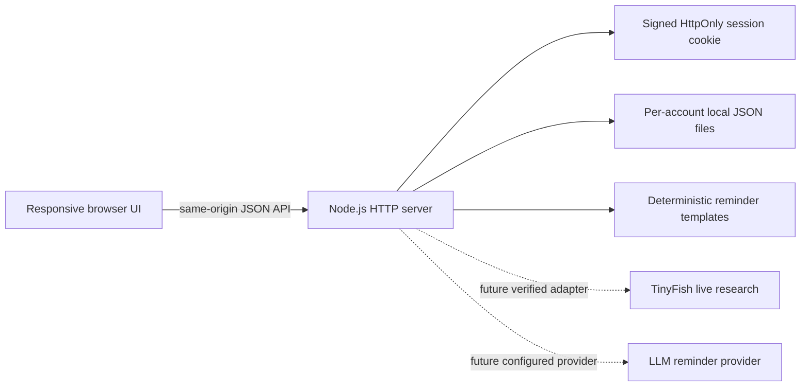

# Dueshield AI

Payment follow-up and receivables workspace for Indian MSMEs. This repository was an empty scaffold when work began; it now contains a runnable, dependency-free local MVP with a browser UI and Node.js REST API.

## Current implementation status

| Area | Status |
|---|---|
| Responsive workspace, sign-in and registration | Implemented |
| Account-isolated invoice records and payment history | Implemented on local file store |
| Balance and due status calculations | Implemented; INR in paise, IST business date |
| Dashboard, aging, top customers and CSV | Implemented from account records |
| Editable reminder draft history | Deterministic template fallback; no LLM configured |
| Research history and honest unavailable state | Implemented; live TinyFish adapter remains blocked pending verified API contract/credentials |
| Per-invoice checklist | Implemented |
| Postgres, Prisma migrations, production deployment, automated suite | Not implemented |

This is not a production-ready deployment. File storage is for local evaluation and is not a substitute for PostgreSQL, backups, or a multi-instance deployment.

## Architecture



The frontend uses browser-native JavaScript and CSS to keep this scaffold runnable without a package install. The API is in `server/src/server.js`; UI files are in `client/`.

## Requirements

- Node.js 20 or newer.
- Optional: Docker Desktop for PostgreSQL. The current MVP does not connect to PostgreSQL yet.

## Run locally

```powershell
Copy-Item .env.example .env
# Set SESSION_SECRET to a random value of at least 32 bytes before production.
npm start
```

Open <http://localhost:3001>. To restart automatically during development, run `npm run dev`. Data is stored in `./data/` and is ignored by Git. Do not use this local file store for production data.

The optional PostgreSQL container can be started with `docker compose up -d postgres` and stopped with `docker compose down`. It is not wired into the MVP yet; no database migrations exist, and `DATABASE_URL` is reserved for the planned Prisma migration.

## Environment

See `.env.example` for the supported local settings:

- `PORT`, `DATA_DIR`, `NODE_ENV`
- `SESSION_SECRET`, `SESSION_DAYS`
- `OPENAI_API_KEY`, `OPENAI_MODEL` (reserved; LLM integration is not implemented)
- `TINYFISH_API_KEY`, `TINYFISH_BASE_URL` (not used until the official contract is verified)

The development session secret has an explicitly local fallback. Production startup refuses a missing/short `SESSION_SECRET`; set it via the hosting platform's secret manager. Never commit `.env`.

## Implemented API (all under `/api/v1`)

Authentication: `POST /auth/register`, `POST /auth/login`, `POST /auth/logout`, `GET /auth/me`.

Receivables: `GET/POST /invoices`, `GET/PATCH/DELETE /invoices/:id`, `GET/POST /invoices/:id/payments`, `GET /dashboard/summary`, `GET /dashboard/analytics`, `GET /reports/receivables`, `GET /reports/export.csv`.

Follow-up: `POST/GET /reminders/generate` (list is `GET /reminders`), `GET/PATCH /reminders/:id`, `POST /reminders/:id/mark-sent`, `GET/POST /invoices/:id/checklist`, `PATCH/DELETE /checklist/:id`, `GET/POST /research`, `GET/PATCH /settings`.

All resource routes require a valid HttpOnly signed session cookie. Errors return JSON `{ "error": "..." }`; common status codes are 400 (validation), 401 (authentication), 404 (not found), 409 (duplicate), 413 (request too large), and 503 (live research unavailable). User data is selected by the authenticated account; invoice IDs are checked against that account before use. Invoice number uniqueness is account-scoped.

### Business rules

- Currency is INR; amounts are converted to integer paise before arithmetic.
- Business day is calculated in `Asia/Kolkata`; timestamps are stored as ISO UTC.
- Due today means a positive balance due on the business date. Overdue means positive balance and an earlier date. Due soon uses the account setting (1–30 days; default 7).
- Full payment yields Paid. Payment entries are immutable through the current API; deletion/adjustment workflow is not provided.
- Cancelled and disputed invoices are not modeled. Do not represent them by manually changing calculated status.
- Deleting an invoice also removes its local reminder and checklist history. There is no account deletion/retention UI yet.

## TinyFish status

Live TinyFish research is **not integrated or verified**. No endpoint, authentication header, request schema, or result format is invented here. The research endpoint preserves the user's question, saves an unavailable session, returns HTTP 503, and does not display generated sources. Before enabling it, consult current official TinyFish documentation, add a server-only adapter with contract validation, timeouts, rate limits, prompt-injection handling, response normalization and mocked tests, then verify one request with valid credentials. `TINYFISH_BASE_URL` is intentionally blank until that verification.

## Security and privacy notes

- Passwords use Node `scrypt` with a random per-account salt; session cookies are HttpOnly and SameSite=Lax, Secure in production, and HMAC-signed.
- Session lifetime is currently fixed at seven days. There is no CSRF token, account recovery, account deletion, rate limiter, or structured audit log.
- Store files are created with restrictive permissions where supported. Local disk is not encrypted by this application. Back up and restrict access to the data directory.
- No invoice or customer data is sent to an AI service. Reminder drafts are deterministic and clearly labelled. Reminders are never sent automatically.
- Production deployment requires PostgreSQL/Prisma, migrations, rate limiting, CSRF review, HTTPS, managed secrets, backups, retention/deletion flows and security review.

## Checks

```powershell
npm run check
```

With the server running in another terminal, `npm run check:smoke` exercises registration, invoice/status calculations, partial and excessive payments, reminder fallback, TinyFish unavailable handling, cross-account ownership, checklist updates, dashboard totals and CSV export. The syntax check covers the server and frontend JavaScript. A full unit, integration and browser automation suite is not present yet.

## Hackathon walkthrough

1. Register with a fictional business account.
2. Add a fictional customer invoice with a due date in the past.
3. Open its detail, record a partial payment, and observe the remaining balance.
4. Draft, edit, copy, and manually mark a payment reminder.
5. Review the per-invoice organization checklist, receivables aging and CSV export.
6. Submit a research question and show the explicit unavailable state until genuine TinyFish credentials and the verified API adapter are provided.

Team: Deep Mind · Team leader: Vishal Kumar Sahu · Kritical Hacks 2026.
